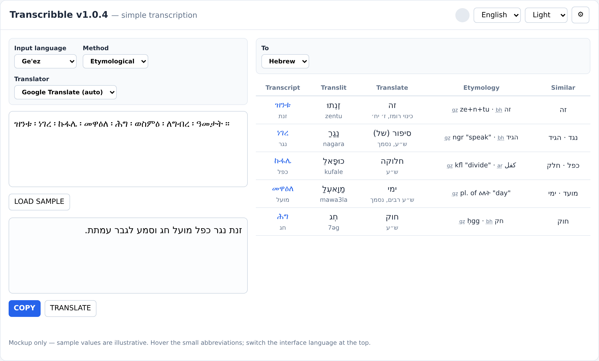
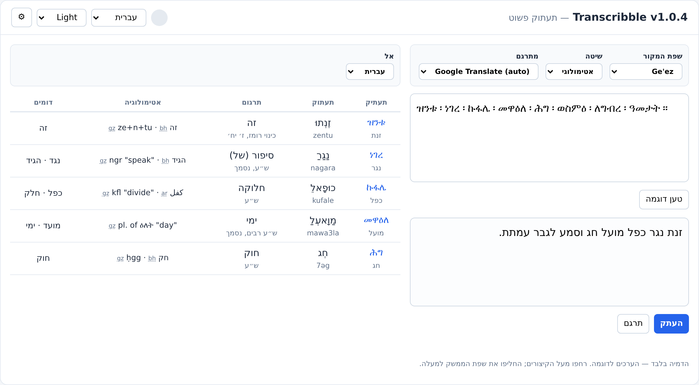

# Transcribble Features v1.0.4

[](https://pashute.github.io/Transcribble/mockup.html)

<details>
<summary>Hebrew interface (RTL)</summary>


</details>

**[Open the live mockup ↗](https://pashute.github.io/Transcribble/mockup.html)**: switch the interface language and hover the abbreviations. The values are illustrative only.

## Layout

<table>
  <tr>
    <td colspan="2" align="center"><b>Header</b> — Transcribble v1.0.4 · simple transcription &nbsp;|&nbsp; Avatar · Language · Theme</td>
  </tr>
  <tr>
    <td width="45%"><b>L1 · Controls</b><br>Input language · Method · Translator</td>
    <td><b>R1 · Controls</b><br>To: Hebrew ▾</td>
  </tr>
  <tr>
    <td><b>L2 · Input</b><br><i>Paste and edit text here</i><br>[LOAD SAMPLE]</td>
    <td rowspan="2"><b>R2 · Word table</b><br>Transcript · Translit · Translate · Etymology · Similar</td>
  </tr>
  <tr>
    <td><b>L3 · Output</b><br>[COPY] [TRANSLATE]</td>
  </tr>
</table>

The two columns swap sides when the UI language is RTL.

### Header

- **Left:** `Transcribble v1.0.4 — simple transcription`
- **Right:** Avatar (login, disabled for now) · UI language (English / Hebrew) · Theme (Dark / Metal / Pastel / Light) · Settings ⚙

### Settings ⚙

A small dialog that opens from the header. Choices are saved for the next visit.

| Setting | Values | Default |
|---|---|---|
| Arabizi: double long vowels (ā → aa) | on / off | **off** |

### Left column

| Part | Contents |
|---|---|
| **L1 Controls** | **Input language:** Auto-detect, Ge'ez, Amharic, Tigrinya, Aramaic, Arabic, Hebrew, Akkadian<br>**Method:** Phonetic / Etymological (preserves glottal & emphatic marks)<br>**Translator (מתרגם):** options depend on the input language (see *Translators*) |
| **L2 Input** | Scrollable, editable text area. Placeholder: *Paste and edit text here*<br>**LOAD SAMPLE**: loads a sample in the selected input language. Ge'ez: Book of Jubilees (*Mets'hafe Kufale*), ch. 1. |
| **L3 Output** | Scrollable, selectable transcript.<br>**COPY**: copies the output.<br>**TRANSLATE**: opens the full text in Google Translate (source: auto, target: the **To:** language). |

### Right column

**R1 Controls**: **To:** Hebrew (default), English. More languages later.

**R2 Word table**: one row per word of the input. A cell can hold two lines (top / bottom). Single-line cells are centered horizontally.

| Column | Top | Bottom |
|---|---|---|
| **Transcript** | original word | transcript in the target script, vowels dropped |
| **Translit** | vocalized transliteration in the target script | Arabizi of the transliteration |
| **Translate** | meaning in context | grammar (POS, person, number, tense) |
| **Etymology** | telegraphic, 3–4 words with abbreviations | — |
| **Similar** | phonetically similar roots with related meanings in Hebrew and other Semitic languages | — |

- **Links:** the top word of a row opens the selected **Translator** for that word.
- **Abbreviations:** language abbreviations expand on hover, e.g. <sub>bh</sub> מחזה ma2ze, where hovering *bh* shows "Biblical Hebrew".

---

## Functionality

- **Transcript drops vowels.** Only consonants are written in the target script (e.g. Hebrew without niqqud). The vowels appear in the **Translit** column.
- **Similar, by meaning.** When the transcript's root has a counterpart in the target language with a similar sound *and* meaning, show it. Example: the transcript gives חטב, meaning "wrote", so Similar shows **כתב**.
- **Samples:** one per input language, loaded with **LOAD SAMPLE**.

### Translators

The **Translator** list is rebuilt whenever the input language changes, and the first option is selected. It controls the word links in the table. **TRANSLATE** (full text) always uses Google Translate.

| Input language | Translator options (first = default) |
|---|---|
| Auto-detect | Google Translate (auto-detect) |
| Ge'ez | Google Translate (auto-detect) · [Dillmann, *Lexicon Linguae Aethiopicae* (Beta maṣāḥǝft)](https://betamasaheft.eu/Dillmann/) · [Leslau, *Comparative Dictionary of Ge'ez*](https://archive.org/details/leslau-comparative-dictionary-of-geez-1987) · English Wiktionary (Ge'ez section) |
| Amharic | Google Translate · AmharicPro · Wiktionary |
| Tigrinya | Google Translate · Wiktionary |
| Aramaic | Wiktionary · CAL (Comprehensive Aramaic Lexicon) |
| Arabic | Google Translate · Wiktionary |
| Hebrew | Google Translate · Wiktionary |
| Akkadian | [Akkadian Dictionary (assyrianlanguages.org)](https://www.assyrianlanguages.org/akkadian/search.php) · Wiktionary |

- **Google Translate** is sent with source = auto and target = the **To:** language.
- **Dillmann** and **Leslau** have no search URL, so they open the dictionary itself and copy the word to the clipboard for pasting.
- **Akkadian Dictionary** opens the search page and copies the word to the clipboard, already converted to the site's notation by the Akkadian module (below). If the site's search accepts a URL parameter, link to the results directly instead (check the form in the page source).

### Akkadian module (`akkadian.js`)

`toAssyrianLanguagesQuery(word)` converts a word into the search notation of assyrianlanguages.org. It accepts scholarly transliteration (*šarrum*) or a Hebrew transcript (שרמ).

| Sound | Translit | Hebrew | Site notation |
|---|---|---|---|
| aleph / ayin | ʾ ʿ | א ע | `'` |
| shin | š | ש | `sz` |
| sadhe | ṣ | צ ץ | `s,` |
| teth | ṭ | ט | `t,` |
| ḫet | ḫ | ח | `h` |
| long vowels | ā ē ī ū, â ê î û | — | a e i u |

- Hyphens (*šar-ru-um*) and sign indices (*ša₂*) are removed, and the result is lower case.
- A Hebrew transcript has no vowels, so the result is consonants only. Add the site's `*` wildcard if needed.
- Tests: `test/akkadian.test.js`.

### Interface language

Supported: **English** (LTR) and **Hebrew** (RTL). Chosen in the header and saved for the next visit. On the first visit it follows the browser language, falling back to English.

Switching it changes:

| Area | What changes |
|---|---|
| **Direction** | The page's `dir` switches between `ltr` and `rtl`. The whole layout mirrors: header ends swap, the left and right columns swap, the word-table columns run right-to-left, and controls align to the start side. |
| **Texts** | Every interface string: header tagline, control labels, option names (e.g. *Etymological* / אטימולוגי), placeholders, button labels, table headers, tooltips, abbreviation expansions on hover, and status messages. |
| **Fonts** | Interface font for the selected script. |

It does **not** change:

- **Content direction.** Each text keeps its own script's direction, whatever the interface language. Ge'ez and Akkadian (transliterated) are LTR. Hebrew, Arabic and Aramaic are RTL. Every table cell and line is direction-isolated (`dir="auto"` / `<bdi>`), so mixed lines such as `gz ngr "speak" · bh הגיד` keep their order.
- **Selections.** The To: language, input language, method and translator stay as set. Only their labels are translated (Ge'ez / געז).

#### Interface language files (`i18n/*.yaml`)

All interface text lives in one YAML file per language: `i18n/en.yaml` and `i18n/he.yaml`. Nothing user-visible is hard-coded in the HTML.

```yaml
meta:    { name: עברית, dir: rtl, font: '"Frank Ruhl Libre", serif' }
header:  { tagline: תעתוק פשוט, ... }
controls: { inputLanguage: שפת המקור, method: שיטה, translator: מתרגם, to: אל }
messages: { searching: "מחפש ב־{source}…" }   # {placeholders} are filled at run time
```

- **Sections:** `meta` (name, `dir`, font), `header`, `themes`, `controls`, `methods`, `languages`, `translators`, `input`, `output`, `table`, `abbrev` (hover expansions), `messages`.
- **Loading:** on start and on every switch, `fetch("i18n/<lang>.yaml")` and parse it with **js-yaml** (one small script from a CDN). Then set `<html lang dir>` from `meta`, and fill every element that has `data-i18n="section.key"`. Placeholders use `data-i18n-placeholder`, tooltips `data-i18n-title`.
- **English file:** yes, keep `en.yaml`. It is the reference list of keys and the fallback: any key missing in another language shows in English instead of breaking. It also keeps the HTML free of text, so wording changes never touch code.
- **Adding a language:** copy `en.yaml`, translate the values, set `meta.dir`, and add it to the language menu. No code changes.
- **Note:** `fetch` doesn't work when `index.html` is opened from disk (`file://`). Use GitHub Pages or a local server (`npx serve`).

### Themes (`themes/*.yaml`)

The four themes (**Light** default, **Dark**, **Metal**, **Pastel**) are one YAML file each, loaded the same way as the interface language files.

```yaml
name: Dark
colors:              # each key becomes a CSS variable: bg → --bg, accentInk → --accent-ink
  bg: "#0f172a"
  panel: "#1e293b"
  ink: "#e2e8f0"
  accent: "#60a5fa"
  ...
radius: 8px          # → --radius
shadow: "0 4px 15px rgba(0,0,0,0.4)"   # → --shadow
```

- **Tokens** (every theme has all of them): `bg`, `panel`, `surface`, `line`, `ink`, `muted`, `accent`, `accentInk`, `inputBg`, `outputBg`, `hover`, plus `radius` and `shadow`.
- **The CSS uses only these variables**, e.g. `background: var(--panel)`, never fixed colors. Switching a theme means setting the variables on `:root`; the CSS doesn't change.
- **Choice is saved** for the next visit. On the first visit, follow the system setting (`prefers-color-scheme`): Dark or Light.
- The theme name shown in the menu comes from the interface language file (`themes.dark` → כהה).
- **Adding a theme:** add a YAML file and list it in the menu.

---

## How each column is produced

### Terms

| Term | What it is | Example (ነገረ) |
|---|---|---|
| **Transcript** | Letter for letter into the target script, **consonants only**. | נגר |
| **Transliteration** | The full **sound**, vowels included, in the target script, plus Arabizi. It is *not* a translation. | נַגַרַ · nagara |
| **Translation** | The **meaning** in this sentence (top) and its grammar (bottom). | account of · noun, construct |

### Sources and credentials

| Column | Source | Free? | Key needed? | Runs in plain HTML? |
|---|---|---|---|---|
| Transcript | Local JS mapping tables (below). The same as v1.0.3, which used **no API**. | ✅ | No | ✅ |
| Translit (Ethiopic, vocalized Arabic/Syriac/Hebrew) | Local JS: vowels read from the characters or points (below). | ✅ | No | ✅ |
| Word link (top word) | A URL to the selected Translator, opened in a new tab. The result is not read back into the page. | ✅ | No | ✅ |
| Grammar (partial) & definitions | **Wiktionary API** (`en.wiktionary.org/w/api.php`, `origin=*`). v1.0.3 already used it for roots, cognates and definitions. Gives the part of speech and sometimes inflection; coverage is incomplete. | ✅ open | No | ✅ |
| Meaning in context | **Google Cloud Translation API**: Amharic, Tigrinya, Arabic, Hebrew. **Not** Ge'ez or Akkadian. No grammar. | Paid, with a free monthly quota | **Yes** (Google Cloud project + API key) | ⚠ only via proxy |
| Meaning in context + grammar + etymology + similar | **AI model API** (Claude, Gemini, OpenAI…), one JSON request per sentence. Covers every input language including Ge'ez and Akkadian. Results for rare languages must be checked. | Paid | **Yes** | ⚠ only via proxy |
| Arabic / Hebrew grammar (alternative) | Open-source analyzers, e.g. CAMeL Tools (Arabic). | ✅ open | No | ❌ needs a server (Python) |

- **API keys never go in the HTML.** Anyone can read them there. Calls that need a key go through a small proxy, e.g. a Cloudflare Worker or Vercel function that holds the key.
- Yes, each language uses different sources. Define them in one config object per input language, like `dictionariesByLanguage` in v1.0.3.
- **Until a proxy exists**, Translate, Etymology and Similar show Wiktionary data when found and otherwise `—`, and the top-word link still works.

### Transcription: the two methods

**Transcription stays exactly as in v1.0.3.** It is a fixed, local letter-for-letter conversion: no API, no dictionary, no guessing. The same input always gives the same output, and it works offline.

How it works: the text is read one character at a time.
- Ge'ez, Amharic and Tigrinya: each syllable character is replaced by the Hebrew letter for its consonant, and its vowel is dropped.
- Arabic and Syriac: the vowel marks are removed and each letter is replaced by its Hebrew counterpart.
- At the end of each word, כ מ נ פ צ change to their final forms. Anything else, such as digits, Latin letters or unknown characters, is copied as is.

The **Method** choice (Ethiopic only) decides how the consonants that merged in modern Amharic are written:
- **Etymological** keeps each historical consonant distinct, e.g. ሐ ח but ኀ ח׳, and ዐ ע.
- **Phonetic** writes them as they are pronounced today: both ח, and ዐ → א.

Carry this over **unchanged from v1.0.3**: the tables `consonantRows`, `arabicLetters` and `syriacLetters`, and the functions `transcribe`, `transcribeArabic` and `transcribeSyriac`. The existing tests in `test/` must keep passing.

**Rules**

1. **Ethiopic (U+1200–U+1357):** each consonant has a row of 8 code points, one per vowel order. Row = `code − code % 8`. Output the row's Hebrew letter; the vowel order is dropped.
2. **Method** applies to Ethiopic only:
   - **Etymological** keeps the historical consonants apart (ሠ שׂ, ኀ ח׳, ኸ כ׳, ዐ ע, ዸ ד׳, ፀ צ׳).
   - **Phonetic** merges them as they sound in modern Amharic (ሠ→ס, ኀ/ኸ→ח, ዐ→א, ዸ→ג׳, ፀ→צ).
3. **Ge'ez punctuation:** ፡ → space · ። → `.` · ፣ → `,` · ፤ → `;` · ፥ ፦ → `:` · ፧ → `?` · ፨ → `¶`.
4. **Arabic:** NFC-normalize. Remove harakat (U+0610–061A, U+064B–065F, U+0670) and tatweel ـ. Map the letters. ، ؛ ؟ → `, ; ?`.
5. **Aramaic / Syriac:** remove vowel points (U+0730–074A). Map the letters.
6. **Final forms:** כ מ נ פ צ → ך ם ן ף ץ at the end of a word, i.e. before a space, punctuation or end of text. For Arabic, also when followed by a geresh.
7. Any character with no mapping passes through unchanged.
8. **New input languages:**
   - **Hebrew:** strip niqqud. The letters stay as they are.
   - **Akkadian:** input is Latin transliteration (e.g. *šarrum*). Map ʾ א · b ב · g ג · d ד · w ו · z ז · ḫ ח · ṭ ט · y י · k כ · l ל · m מ · n נ · s ס · p פ · ṣ צ · q ק · r ר · š ש · t ת. Drop the vowels, **except e / ē, which becomes ע**. In Akkadian, e usually marks a lost guttural, so *bēl* → **בעל** (cf. Hebrew בַּעַל).

**Ethiopic table** (bold = the two methods differ: Etymological / Phonetic)

ሀ ה · ለ ל · ሐ ח · መ מ · **ሠ שׂ / ס** · ረ ר · ሰ ס · ሸ שׁ<br>
ቀ ק · ቐ ק׳ · በ ב · ቨ ו · ተ ת · ቸ צ׳ · **ኀ ח׳ / ח** · ነ נ<br>
ኘ נ׳ · አ א · ከ כ · **ኸ כ׳ / ח** · ወ ו · **ዐ ע / א** · ዘ ז · ዠ ז׳<br>
የ י · ደ ד · **ዸ ד׳ / ג׳** · ጀ ג׳ · ገ ג · ጘ ג׳ · ጠ ט · ጨ צ׳<br>
ጰ פ׳ · ጸ צ · **ፀ צ׳ / צ** · ፈ פ · ፐ פּ

**Arabic table:** ا أ إ آ ٱ ء ى→א · ؤ و→ו · ئ ي→י · ب ב · ت ת · ث ת׳ · ج ג׳ · ح ח · خ ח׳ · د ד · ذ ד׳ · ر ר · ز ז · س ס · ش שׁ · ص צ · ض צ׳ · ط ט · ظ ט׳ · ع ע · غ ע׳ · ف פ · ق ק · ك כ · ل ל · م מ · ن נ · ه ة→ה

**Syriac table:** ܐ א · ܒ ב · ܓ ג · ܕ ד · ܗ ה · ܘ ו · ܙ ז · ܚ ח · ܛ ט · ܝ י · ܟ כ · ܠ ל · ܡ מ · ܢ נ · ܣ ס · ܥ ע · ܦ פ · ܨ צ · ܩ ק · ܪ ר · ܫ שׁ · ܬ ת

### Transliteration (new)

Built locally: the transcript's consonants, plus vowel points that follow fixed rules. **Long and short vowels are written differently**:

| Vowel | Short | Long |
|---|---|---|
| a | patah ַ | kamatz + alef ָא |
| e | segol ֶ | tzere ֵ |
| i | hirik ִ | hirik male ִי (with yod) |
| o | kamatz (katan) ָ | holam male וֹ |
| u | kubutz ֻ | shuruk וּ |
| ə / no vowel | shva ְ (nothing at word end) | — |

**Long or short?** Decided per language:

| Language | Long | Short |
|---|---|---|
| **Ge'ez / Amharic / Tigrinya** (order = `code % 8`) | 2nd u · 3rd i · 4th ā · 5th e · 7th o | 1st a (ä) · 6th ə (shva) · 8th wa = ו + kamatz+alef |
| **Akkadian** (Latin input) | marked: ā ē ī ō ū or â ê î ô û | unmarked: a e i o u |
| **Arabic** | fatha + ا · kasra + ي · damma + و | fatha · kasra · damma alone |
| **Syriac / Hebrew** | from the vowel points, when present | |

- **Akkadian e → ע:** as in the transcript, e / ē is written as ע, and the vowel point goes on the ע. Example: *bēlum* → בְעֵלֻם, transcript בעלם (*bēl* → בעל).
- **Examples (Ge'ez):** ኩፋሌ *kufāle* → כוּפָאלֵ · ነገረ *nagara* → נַגַרַ · ሕግ *ḥəgg* → חְג.
- **No vowel marks in the input** (unvocalized Arabic, Syriac or Hebrew): the translit comes from the dictionary or AI source, or shows `—`.
- **Vowel letters only in the transliteration.** The extra letters for long vowels (holam male וֹ, shuruk וּ, hirik male ִי, and the alef of long a) appear only in the transliteration. The transcript stays consonants only.
- **Without yod:** short hirik ִ, tzere ֵ (long e) and patah ַ never get a yod.
- **Arabizi line:** Latin letters plus ʾ→2 · ʿ→3 · ḫ/kh→5 · ṭ→6 · ḥ→7 · ṣ→9 · š→sh · ġ→gh.
  - **Akkadian only:** e / ē → 3, matching the ע of the transcript (*bēl* → b3l).
  - **Long vowels doubled** (ā→aa, ī→ii, ū→uu) is an on/off option in Settings. **Default: off.**
